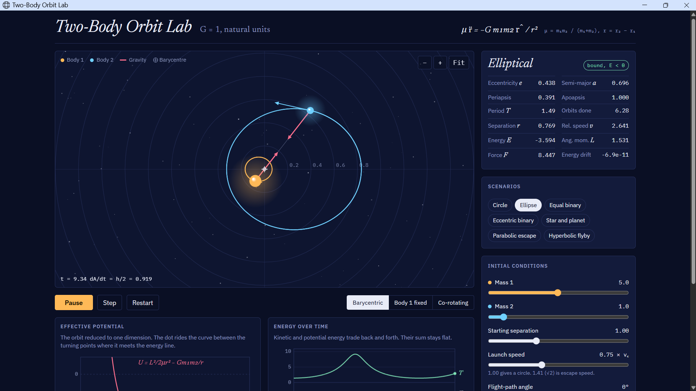
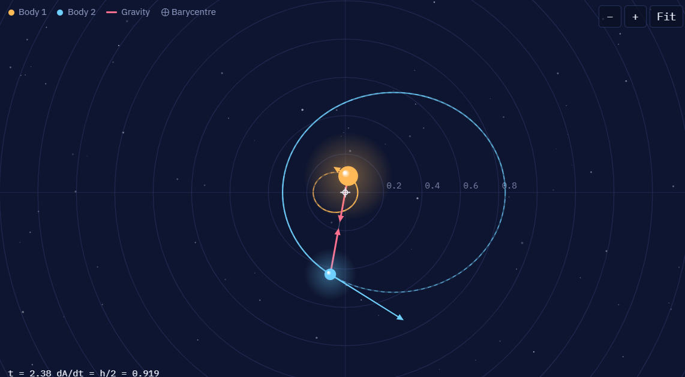
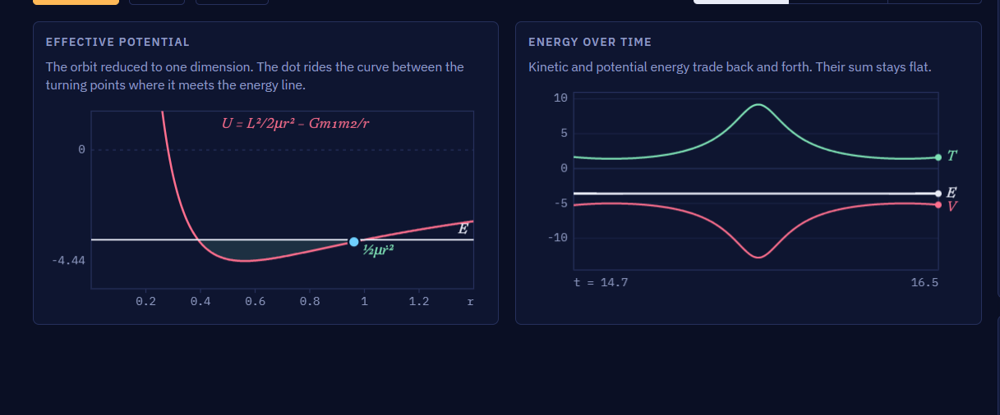
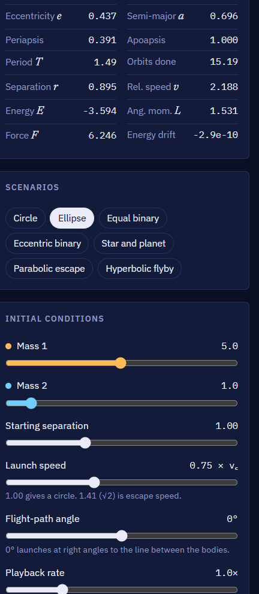

# Two-Body Orbit Lab

### ME206 – Statics and Dynamics | Assignment 4

An interactive **Two-Body Gravitational Orbit Simulator** developed as a supplementary project for the ME206 Statics and Dynamics course.

The project demonstrates the gravitational interaction between two bodies and allows users to explore orbital mechanics through an interactive graphical interface, real-time physics calculations, and energy visualizations.

---

## 1. Project Overview

The Two-Body Orbit Lab is an interactive physics simulation that models the motion of two bodies under their mutual gravitational attraction.

Users can modify the masses of the bodies, initial separation, launch speed, and flight-path angle to observe how different initial conditions affect their orbital trajectories.

The simulator also provides different reference frames, orbital parameters, force and velocity visualizations, and energy graphs.

The simulation uses natural units with the gravitational constant set to \(G=1\).

## 2. Project Objectives

- Understand Newton's law of universal gravitation.
- Study the motion of two bodies under mutual gravitational attraction.
- Understand the concept of reduced mass.
- Visualize circular, elliptical, parabolic, and hyperbolic orbits.
- Study conservation of mechanical energy and angular momentum.
- Understand barycentric motion and relative motion.
- Explore how initial conditions affect orbital trajectories.
- Understand the application of numerical integration in solving equations of motion.

---

## 3. Live Demo

The interactive simulator is available online through GitHub Pages.

**[Launch Two-Body Orbit Lab](https://thrishakunala.github.io/Two-Body-Orbit-Lab/)**

You can interact with the simulator directly in your web browser without downloading the project files.

## 4. GitHub Repository

The complete source code, simulation files, documentation, and supporting screenshots are available here:

**[View Two-Body Orbit Lab on GitHub](https://github.com/thrishakunala/Two-Body-Orbit-Lab)**

---

## 5. Features of the Simulator

### 5.1 Interactive Orbit Simulation

- Real-time simulation of two gravitationally interacting bodies.
- Adjustable mass of both bodies.
- Adjustable initial separation between bodies.
- Adjustable launch speed and flight-path angle.
- Play, pause, restart, and single-step simulation controls.
- Adjustable simulation playback speed.
- Zoom and fit-to-screen controls.

### 5.2 Orbital Configurations

The simulator provides several preset scenarios:

- **Circular Orbit:** Demonstrates a circular orbital trajectory.
- **Elliptical Orbit:** Shows an elliptical orbital path.
- **Equal Binary:** Simulates two bodies with equal masses orbiting their common center of mass.
- **Eccentric Binary:** Demonstrates an eccentric binary system.
- **Star and Planet:** Models a system with a massive central body and a lighter orbiting body.
- **Parabolic Escape:** Demonstrates the limiting escape trajectory.
- **Hyperbolic Flyby:** Shows an unbound gravitational flyby trajectory.

### 5.3 Reference Frames

Three reference frames are available:

- **Barycentric Frame:** Motion observed relative to the common center of mass.
- **Body-1-Fixed Frame:** Motion observed relative to the first body.
- **Co-Rotating Frame:** A rotating reference frame that follows the orbital configuration.

### 5.4 Visualization Tools

- Force and velocity vectors.
- Predicted conic-section trajectory.
- Orbital trails.
- Equal-area visualization.
- Interactive body dragging.
- Velocity adjustment by dragging vector tips when the simulation is paused.

### 5.5 Real-Time Physics Data

The simulator calculates and displays:

- Orbital eccentricity.
- Semi-major axis.
- Periapsis.
- Apoapsis.
- Orbital period.
- Number of completed orbits.
- Distance between the bodies.
- Relative speed.
- Total mechanical energy.
- Angular momentum.
- Gravitational force.
- Energy drift.

### 5.6 Graphical Analysis

The simulator includes two interactive graphs:

1. **Effective Potential:** Displays the effective potential curve and the relationship between the energy level and orbital turning points.
2. **Energy Over Time:** Displays kinetic energy, gravitational potential energy, and total mechanical energy during the simulation.

These graphs help demonstrate the exchange between kinetic and potential energy and the conservation of total mechanical energy.

---

## 6. Physics and Mathematical Background

The simulation is based on Newton's law of universal gravitation and the equations governing two-body motion.

### 6.1 Gravitational Force

According to Newton's law of universal gravitation, the attractive force between two bodies is:

$$
F = \frac{Gm_1m_2}{r^2}
$$

Where:

- \(G\) = Gravitational constant
- \(m_1, m_2\) = Masses of the two bodies
- \(r\) = Distance between their centers

### 6.2 Reduced Mass

The two-body problem can be simplified into an equivalent one-body problem using the reduced mass:

$$
\mu = \frac{m_1m_2}{m_1+m_2}
$$

Where:

- \(\mu\) = Reduced mass
- \(m_1, m_2\) = Masses of the two bodies

### 6.3 Relative Equation of Motion

The relative motion of the two bodies is governed by:

$$
\mu \ddot{\mathbf{r}} =
-\frac{Gm_1m_2}{r^2}\hat{\mathbf{r}}
$$

Where:

- \(\mathbf{r}\) = Relative position vector
- \(\ddot{\mathbf{r}}\) = Relative acceleration
- \(\hat{\mathbf{r}}\) = Unit vector along the line joining the two bodies

### 6.4 Total Mechanical Energy

The total mechanical energy is the sum of kinetic and gravitational potential energy:

$$
E = KE + PE
$$

### 6.5 Kinetic Energy

The relative kinetic energy is:

$$
KE = \frac{1}{2}\mu v^2
$$

Where:

- \(\mu\) = Reduced mass
- \(v\) = Relative velocity

### 6.6 Gravitational Potential Energy

The gravitational potential energy is:

$$
PE = -\frac{Gm_1m_2}{r}
$$

### 6.7 Conservation of Energy

For an ideal isolated two-body gravitational system, total mechanical energy remains constant:

$$
E = \text{Constant}
$$

The simulator displays energy drift to help observe the numerical accuracy of the simulation.

### 6.8 Angular Momentum

The angular momentum of the relative motion is:

$$
\mathbf{L} = \mu(\mathbf{r}\times\mathbf{v})
$$

For an ideal two-body gravitational system, angular momentum is conserved.

---

## 7. Numerical Method

The simulator uses the **Fourth-Order Runge-Kutta (RK4) numerical integration method** to calculate the motion of the bodies over time.

RK4 numerically solves the equations of motion by estimating the system's state at successive time steps.

The integration time step is tied to the local orbital timescale to improve numerical behavior during the motion.

This method allows the simulator to calculate the changing positions and velocities of the bodies and generate their orbital trajectories.

---

## 8. Software Requirements

The following software is required to run the project:

| Requirement | Description |
|---|---|
| Operating System | Windows, macOS, or Linux |
| Web Browser | Google Chrome, Microsoft Edge, Mozilla Firefox, or another modern HTML5-compatible browser |
| Internet Connection | Recommended for loading Google Fonts |
| Additional Software | No additional software installation is required for the browser-based simulator |

**Note:** The `.bat` launcher is intended for Windows. The HTML simulator can be opened directly in a compatible web browser on supported operating systems.

---

## 9. Technologies and Dependencies

### Technologies Used

- **HTML5:** Structure of the simulator.
- **CSS3:** Styling and user interface.
- **JavaScript:** Physics calculations and simulation logic.
- **HTML Canvas API:** Rendering orbital trajectories, bodies, and visualizations.
- **Google Fonts:** Interface typography.

### Dependencies

The project uses standard web technologies.

- No external JavaScript frameworks are required.
- No external JavaScript libraries are required.
- No package manager or build tools are required.
- No additional software installation is needed to run the HTML simulator.

Google Fonts are loaded externally for typography, so an internet connection is recommended. The core simulation does not depend on external JavaScript libraries.

---

## 10. Project File Structure

The repository is organized as follows:

```text
Two-Body-Orbit-Lab/
│
├── README.md
├── index.html
├── two-body-orbit-lab.html
├── Two-Body Orbit Lab.bat
│
├── main-interface.png
├── elliptical-orbit.png
├── energy-graphs.png
└── binary-system.png
```

### File Descriptions

| File | Description |
|---|---|
| `README.md` | Project documentation, requirements, and execution instructions. |
| `index.html` | Copy of the main HTML file used as the entry point for GitHub Pages. |
| `two-body-orbit-lab.html` | Main simulator source code containing the interface, physics calculations, and visualization. |
| `Two-Body Orbit Lab.bat` | Windows batch file used to launch the simulator in an app-style browser window when supported. |
| `main-interface.png` | Screenshot of the main simulator interface. |
| `elliptical-orbit.png` | Screenshot demonstrating an elliptical orbit. |
| `energy-graphs.png` | Screenshot showing the energy graphs. |
| `binary-system.png` | Screenshot demonstrating a binary system. |

**Important:** `index.html` should contain the same simulator code as `two-body-orbit-lab.html`. Keep the original HTML file because the Windows batch launcher uses its original filename.

---

## 11. Installation and Execution Instructions

No installation or compilation is required.

### Method 1: Run Using the HTML File

1. Download or clone this GitHub repository.
2. Open the downloaded project folder.
3. Locate `two-body-orbit-lab.html`.
4. Double-click the HTML file.
5. The simulator will open in your default web browser.

### Method 2: Run Using the Windows Batch File

1. Download or clone the repository.
2. Make sure `Two-Body Orbit Lab.bat` and `two-body-orbit-lab.html` are in the same folder.
3. Double-click `Two-Body Orbit Lab.bat`.
4. The launcher attempts to open the simulator in an app-style Microsoft Edge or Google Chrome window.
5. If the supported browser is unavailable, it opens the HTML file using the default application.

### Method 3: Run Online Using GitHub Pages

1. Open the GitHub repository.
2. Navigate to **Settings → Pages**.
3. Under Build and deployment, select **Deploy from a branch**.
4. Select the `main` branch.
5. Select the `/(root)` folder.
6. Click **Save**.
7. Wait for GitHub Pages to publish the website.
8. Open the published website link:

   **https://thrishakunala.github.io/Two-Body-Orbit-Lab/**

The online simulator can be accessed without downloading the project files.

---

## 12. How to Use the Simulator

1. Open the simulator in a web browser.
2. Select one of the available orbital presets.
3. Adjust the masses of the two bodies.
4. Modify the initial separation, launch speed, and flight-path angle.
5. Press **Play** to start the simulation.
6. Use **Pause** to stop the simulation and **Step** to advance it one step at a time.
7. Observe the orbital paths, force vectors, and velocity vectors.
8. Switch between reference frames to understand the motion from different perspectives.
9. Study the effective potential and energy graphs.
10. Use **Restart** to reset the simulation.

### Keyboard Shortcut

- Press the **Space key** to toggle between Play and Pause.

### Interactive Controls

- Drag a body to change its position.
- Pause the simulation and drag a velocity arrow tip to change the velocity.
- Use the zoom controls to adjust the viewing scale.
- Enable or disable the visualization options using the available controls.

---

## 13. Reproducibility

The simulation can be reproduced using the files available in this repository.

To reproduce the results:

1. Download or clone the complete repository.
2. Open the simulator using a compatible web browser.
3. Select a predefined orbital scenario or configure the initial parameters manually.
4. Run the simulation.
5. Observe the resulting trajectories and real-time physics quantities.
6. Compare the energy and effective potential graphs for different initial conditions.

The project does not require external JavaScript libraries, package installation, or compilation.

For consistent comparisons, use the same initial masses, separation, launch speed, and flight-path angle.

---

## 14. Applications in Statics and Dynamics

This project demonstrates several important concepts related to engineering mechanics and dynamics:

- Newton's laws of motion.
- Gravitational force and central-force motion.
- Relative motion of particles.
- Center of mass and barycentric motion.
- Circular and curvilinear motion.
- Conservation of mechanical energy.
- Conservation of angular momentum.
- Numerical methods for solving equations of motion.
- Orbital mechanics and trajectory analysis.

The project connects theoretical concepts from the Statics and Dynamics course with an interactive visual simulation.

---

## 15. Supporting Screenshots

The following screenshots demonstrate the simulator's interface and functionality.

### Main Simulator Interface



### Elliptical Orbit



### Energy Graphs



### Binary System



---

## 16. Conclusion

The Two-Body Orbit Lab provides an interactive way to study the gravitational interaction between two bodies.

By allowing users to modify initial conditions and observe the resulting motion, the simulator demonstrates how gravitational forces influence orbital trajectories.

It also provides a practical understanding of reduced mass, reference frames, conservation laws, and numerical integration methods.

This project connects theoretical concepts from the ME206 Statics and Dynamics course with a visual and interactive simulation.

---

## 17. Course and Assignment Information

**Course:** ME206 – Statics and Dynamics

**Assignment:** Assignment 4 – Supplementary Material Submission

**Project Title:** Two-Body Gravitational Orbit Simulator

**Project Type:** Interactive Physics Simulation

**Technologies:** HTML5, CSS3, JavaScript, and Canvas API

**GitHub Repository:** https://github.com/thrishakunala/Two-Body-Orbit-Lab

**Live Simulator:** https://thrishakunala.github.io/Two-Body-Orbit-Lab/

---

**Developed as part of the ME206 Statics and Dynamics course assignment.**
